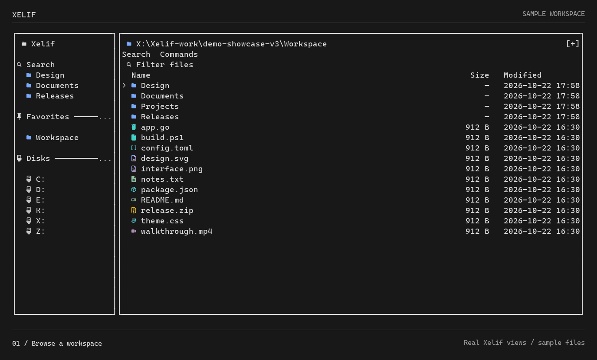
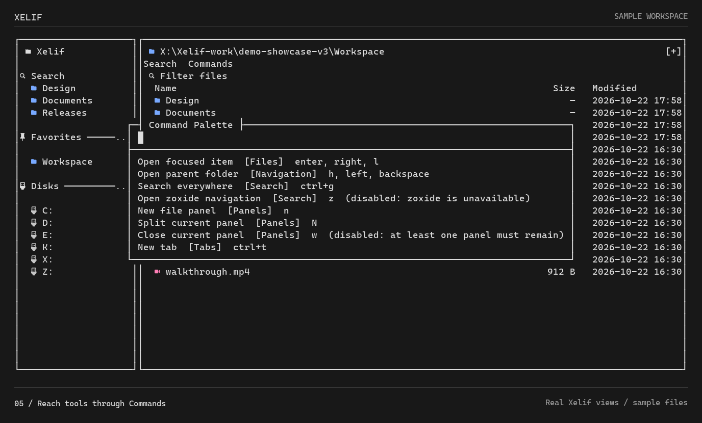

# Xelif

A terminal file manager with mouse and keyboard access. Built on [superfile](https://github.com/yorukot/superfile), developed by [ASVLCII](https://github.com/ASVLCII).

[Demo](#demo) · [Build](#build-from-source) · [Controls](#getting-around) · [Feature guide](website/src/content/docs/features.md) · [Verification](docs/completion-audit.md)


## Demo

Browse files, move through individual rows, filter a folder, select a range, open Commands, and reveal the information panels.

<details>
<summary>Watch the walkthrough</summary>



</details>

<details>
<summary>See the command palette</summary>



</details>

These are reproducible frames from Xelif's real TUI renderer, using disposable sample files—not a generated mockup or an OS terminal recording. The static screenshot is the default; animation is optional. [Demo source and reproduction](docs/media/README.md).

## What is different

| Area | Xelif |
| --- | --- |
| Navigation | Clickable breadcrumbs, tabs, sidebar folders, columns, Search, and Commands; keyboard alternatives remain available. |
| Presentation | Customizable monochrome default, recognizable color-coded file-type icons, compact controls, optional information panels. |
| Search | Direct Everything integration on Windows, advanced filters, saved searches, and bounded local fallbacks. |
| Workspaces | Multiple panels, independent tabs and history, session restoration, and named workspaces. |
| File tools | Range selection, batch-rename previews, ZIP browsing, duplicate detection, directory comparison, and copy-missing previews. |

Also includes Git status/actions, tags and collections, metadata preview/restore, declarative command plugins, and read-only rclone browsing with explicit downloads. See the [feature guide](website/src/content/docs/features.md) for prerequisites, commands, and safety boundaries.

## Build from source

**Development snapshot—not a stable release.** There are no Xelif-specific packaged releases yet. Existing superfile installers and package-manager entries install upstream superfile, not this fork.

Requires Go 1.26 or later.

```sh
git clone https://github.com/ASVLCII/Xelif.git
cd Xelif
go build -o bin/xelif .
./bin/xelif
```

On Windows, use these build/run commands instead:

```powershell
go build -o bin/xelif.exe .
.\bin\xelif.exe
```

A Nerd Font is recommended for the illustrated icons; the demo uses CaskaydiaMono Nerd Font Mono. Windows Terminal is the primary development environment. Everything must be installed and running for its native Windows search provider; local search remains available without it.

Xelif currently retains superfile's Go module path, `spf` compatibility, and configuration directory names. These are intentional compatibility choices.

## Getting around

| Action | Mouse | Default keyboard |
| --- | --- | --- |
| Open an item | Double-click | `Enter` / `Right` |
| Parent folder | Click a breadcrumb | `Left` / `Backspace` |
| Filter this folder | Click the search field | `/` |
| Search everywhere | Click **Search** | `Ctrl+G` |
| Command palette | Click **Commands** | `Ctrl+Shift+P` / `Alt+P` |
| Information panels | Use the footer command | `Shift+F` |
| Range selection | Selection controls | `Shift+Space` |

Bindings are customizable. Mouse-wheel handling advances one row per wheel event; physical wheels and terminals can emit multiple events.

## Performance and verification

The earlier refresh benchmark measured about **32–35% less time for navigation plus visible file/sidebar rendering** after avoiding redundant filesystem reads. That is not a claim about whole-app speed, terminal paint latency, or outperforming Everything. Forced reload costs were broadly unchanged in the measured run. The newer rendering pass reduces temporary allocations while ordinary navigation timing remains approximately unchanged; both comparisons are documented below.

- [Reproducible performance comparison](docs/benchmarks/refresh-optimization.md)
- [Rendering allocation and output-parity checks](docs/benchmarks/standout-render.md)
- [Verification history and limitations](docs/verification.md)
- [Remaining live acceptance checks](docs/completion-audit.md)
- [Configuration reference](website/src/content/docs/configure/superfile-config.mdx)

Local tests, lint, and cross-builds are not substitutes for live validation on every platform. Expanded features remain subject to the acceptance checks above.

Public CI is not green yet: the initial [macOS Go test run](https://github.com/ASVLCII/Xelif/actions/runs/39762441049) and [inherited Python integration suite](https://github.com/ASVLCII/Xelif/actions/runs/39762440765) have failures. These remain visible rather than being presented as passing release checks.

## Attribution and license

Xelif is derived from **superfile**, created by [yorukot](https://github.com/yorukot) and its [contributors](https://github.com/yorukot/superfile/graphs/contributors). Upstream history and attribution are preserved.

[MIT License](LICENSE) · [Third-party notices](NOTICE.md) · [Upstream project](https://github.com/yorukot/superfile)

The source and upstream assets remain in the repository; this README's demo depicts Xelif rather than an inherited upstream screenshot.
