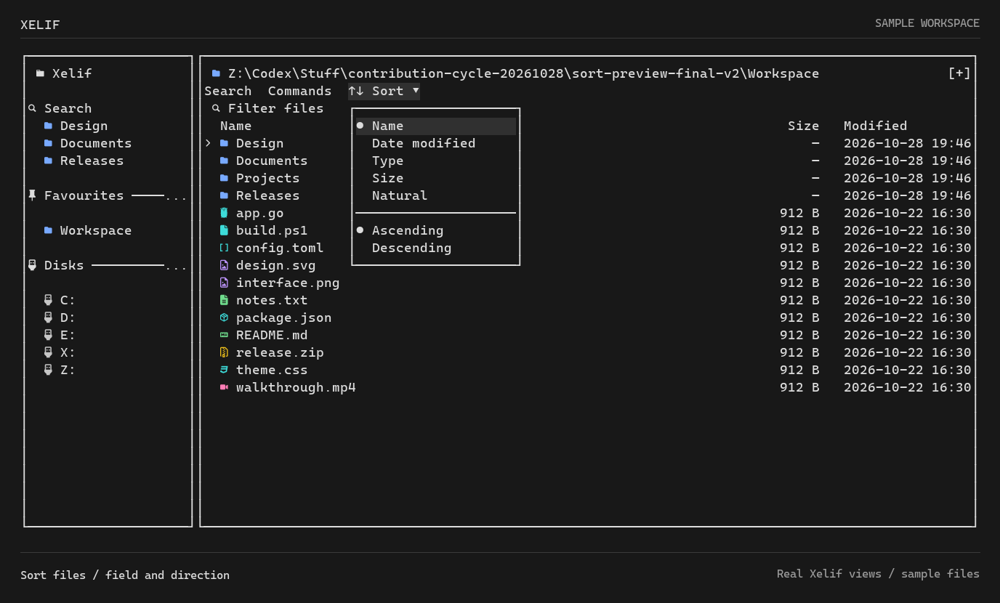

# Xelif

A terminal file manager with mouse and keyboard access. Inspired by [superfile](https://github.com/yorukot/superfile), developed by [ASVLCII](https://github.com/ASVLCII).

[Demo](#demo) · [Install](#install) · [Build](#build-from-source) · [Controls](#getting-around) · [Feature guide](website/src/content/docs/features.md) · [Verification](docs/completion-audit.md)


## Demo

Browse files, move through individual rows, filter a folder, select a range, open Commands, and reveal the information panels.

<details>
<summary>Watch the walkthrough</summary>


</details>

<details>
<summary>See the command palette</summary>


</details>

These are reproducible frames from Xelif's real TUI renderer, using disposable sample files—not a generated mockup or an OS terminal recording. The static screenshot is the default; animation is optional. [Demo source and reproduction](docs/media/README.md).

## What is different

| Area | Xelif |
| --- | --- |
| Navigation | Clickable breadcrumbs, tabs, sidebar folders, columns, Search, and Commands; keyboard alternatives remain available. |
| Presentation | Customizable monochrome default, recognizable color-coded file-type icons, compact controls, optional information panels. |
| Search | Direct Everything integration on Windows, advanced filters, saved searches, and bounded local fallbacks. |
| Workspaces | Multiple panels, independent tabs and history, session restoration, and named workspaces. |
| File tools | Range selection, batch-rename previews, ZIP browsing, duplicate detection, directory comparison, and copy-missing previews. |

Also includes Git status/actions, tags and collections, metadata preview/restore, declarative command plugins, and read-only rclone browsing with explicit downloads. See the [feature guide](website/src/content/docs/features.md) for prerequisites, commands, and safety boundaries.

Click **Sort** beside Search and Commands for an anchored dropdown: Name, Date
modified, Type, Size, or Natural, with separate Ascending and Descending choices.
The active choices are marked with dots. Use Up/Down and Enter, or click a row;
Escape or a click outside dismisses it. Sorting keeps the same item focused.



Undo records the filesystem identity of each moved item. If a path is replaced
after the undo journal is recorded, Undo refuses to move that replacement. Edits
to the same file remain undoable. Identity checks and the later move are separate
operations, so they do not eliminate every concurrent filesystem race.

## Install

**GitHub release: `0.1.2` — Sort button.** Download a native archive from
[GitHub Releases](https://github.com/ASVLCII/Xelif/releases/tag/v0.1.2), extract it,
and run `xelif` (`xelif.exe` on Windows).

The npm `latest` release is currently `0.1.0`; it does not include the new Sort
button. To install that published
[`@asvlcii/xelif`](https://www.npmjs.com/package/@asvlcii/xelif) package with
either npm or Bun. Native executables are available for Windows, macOS and Linux
on x64 and ARM64.

```sh
npm install -g @asvlcii/xelif@latest
# or
bun add -g @asvlcii/xelif@latest
```

Then launch it from any directory:

```sh
xelif
# Or open a particular folder:
xelif "/path/to/a folder"
```

Install Node.js 22+ for the global launcher, including when installing with Bun.
Keep optional dependencies enabled: they select the executable for your machine.
A Go compiler is not needed. A Nerd Font is recommended for file-type icons.

The package uses exact-version optional dependencies, no postinstall scripts or
downloads, and a small Node.js 22+ launcher for the existing Go application.
[Packaging and verification](docs/npm-packaging.md). Running the same install
command again updates to the current stable release. If another Xelif installation opens,
check `Get-Command xelif -All` in PowerShell or `command -v xelif` on Unix.

## Build from source

Build from source if you prefer not to use the package above. Existing superfile installers and package-manager entries install upstream superfile, not Xelif.

Requires Go 1.26 or later.

```sh
git clone https://github.com/ASVLCII/Xelif.git
cd Xelif
go build -o bin/xelif .
./bin/xelif
```

On Windows, use these build/run commands instead:

```powershell
go build -o bin/xelif.exe .
.\bin\xelif.exe
```

A Nerd Font is recommended for the illustrated icons; the demo uses CaskaydiaMono Nerd Font Mono. Windows Terminal is the primary development environment. Everything must be installed and running for its native Windows search provider; local search remains available without it.

Xelif currently retains superfile's Go module path, `spf` compatibility, and configuration directory names. These are intentional compatibility choices.

## Getting around

| Action | Mouse | Default keyboard |
| --- | --- | --- |
| Open an item | Double-click | `Enter` / `Right` |
| Parent folder | Click a breadcrumb | `Left` / `Backspace` |
| Filter this folder | Click the search field | `/` |
| Search everywhere | Click **Search** | `Ctrl+G` |
| Command palette | Click **Commands** | `Ctrl+Shift+P` / `Alt+P` |
| Favourite a folder | Right-click a folder or sidebar entry → **Toggle favourite** | `Shift+P`; sidebar context menu: `Shift+F10` |
| Information panels | Use the footer command | `Shift+F` |
| Range selection | Selection controls | `Shift+Space` |

Bindings are customizable. Mouse-wheel handling advances one row per wheel event; physical wheels and terminals can emit multiple events.

## Performance and verification

The earlier refresh benchmark measured about **32–35% less time for navigation plus visible file/sidebar rendering** after avoiding redundant filesystem reads. That is not a claim about whole-app speed, terminal paint latency, or outperforming Everything. Forced reload costs were broadly unchanged in the measured run. The newer rendering pass reduces temporary allocations while ordinary navigation timing remains approximately unchanged; both comparisons are documented below.

- [Reproducible performance comparison](docs/benchmarks/refresh-optimization.md)
- [Rendering allocation and output-parity checks](docs/benchmarks/standout-render.md)
- [Verification history and limitations](docs/verification.md)
- [Remaining live acceptance checks](docs/completion-audit.md)
- [Configuration reference](website/src/content/docs/configure/superfile-config.mdx)

Local tests, lint, and cross-builds are not substitutes for live validation on every platform. Expanded features remain subject to the acceptance checks above.

The portability follow-up passed [Go CI on Windows, macOS and Linux](https://github.com/ASVLCII/Xelif/actions/runs/39833175305), the [Python integration suite](https://github.com/ASVLCII/Xelif/actions/runs/39833175330), and [module-tidy checks](https://github.com/ASVLCII/Xelif/actions/runs/39833175292). Those results apply to commit `6838f10`, not automatically to later changes; native interactive macOS/Linux acceptance and the Everything speed comparison remain separate gates.

## Attribution and license

Xelif is derived from **superfile**, created by [yorukot](https://github.com/yorukot) and its [contributors](https://github.com/yorukot/superfile/graphs/contributors). Upstream history and attribution are preserved.

[MIT License](LICENSE) · [Third-party notices](NOTICE.md) · [Upstream project](https://github.com/yorukot/superfile)

The source and upstream assets remain in the repository; this README's demo depicts Xelif rather than an inherited upstream screenshot.
